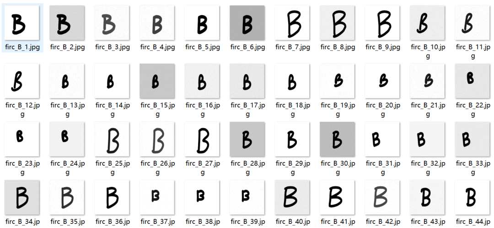
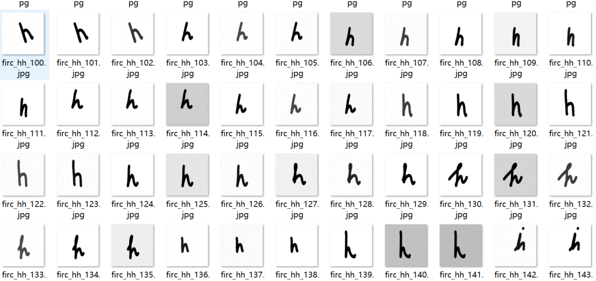
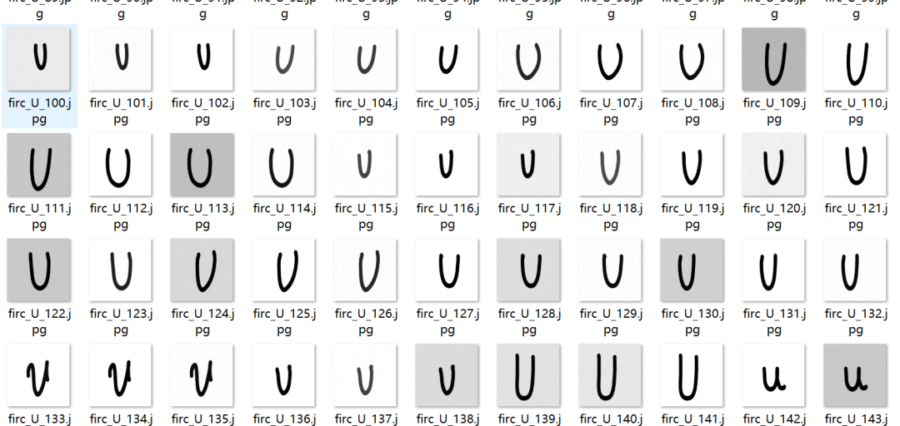

# Handwritten Digits and Capital Letters Classification Dataset 10230 Images 62 Categories

Dataset type: Image classification, not for object detection without annotations.

Dataset format: Only contains jpg images, each category folder contains the corresponding image.

Number of images (number of jpg files): 10230

Category: 62

Category Name: ["0", "1", "2", "3", "4", "5", "6", "7", "8", "9", "A", "B", "C", "D", "E", "F", "G", "H", "I", "J", "K", "L", "M", "N", "O", "P", "Q", "R", "S", "T", "U", "V", "W", "X", "Y", "Z", "aa", "bb", "cc", "dd", "ee", "ff", "gg", "hh", "ii", "jj", "kk", "ll", "mm", "nn", "oo", "pp", "qq", "rr", "ss", "tt", "uu", "vv", "ww", "xx", "yy", "zz"]

Number of images per category:

0 Images: 165

1. Image count: 165

2. Number of images: 165

3. Number of images: 165

4. Number of images: 165

5 Images: 165

6 Pictures: 165

7. Number of images: 165

8 Pictures: 165

9 Pictures: 165

A picture count: 165

B. Number of images: 165

C. Number of images: 165

D. Number of images: 165

E. Number of images: 165

F 165 images

G. Number of images: 165

H 165

I img count: 165

J Pictures: 165

K 165

L 165

M 165

N Number of images: 165

Output: 165

P 165

Q: Number of images: 165

R 165

S 165

T 165

U Image Count: 165

V. Number of images: 165

W 165

X number of images: 165

Y 165

Z img count: 165

aa 165 images

bb image count: 165

cc 165

dd image count: 165

Images: 165

FF image count: 165

gg Image count: 165

hh Image count: 165

II. Number of Images: 165

jj Image count: 165

kk Image count: 165

165 images

mm 165

nn Image count: 165

Oo image count: 165

pp 165 images

QQ image count: 165

rr Image count: 165

SS image count: 165

Image count: 165

uu Image count: 165

vv Image count: 165

Images: 165

xx Image count: 165

yy image count: 165

zz Image count: 165

Important Notice: No

Special : This dataset does not guarantee the accuracy of the trained models or weight files. The dataset is provided for accurate and reasonable classification storage only.

Image Preview:

## Payment

Here is a pay link on Stripe ( https://buy.stripe.com/3cs8yP7sY87d0vu9AB ). Please contact me lonlonago@foxmail.com after funding $89, and I will send you a complete data files , thank you!

